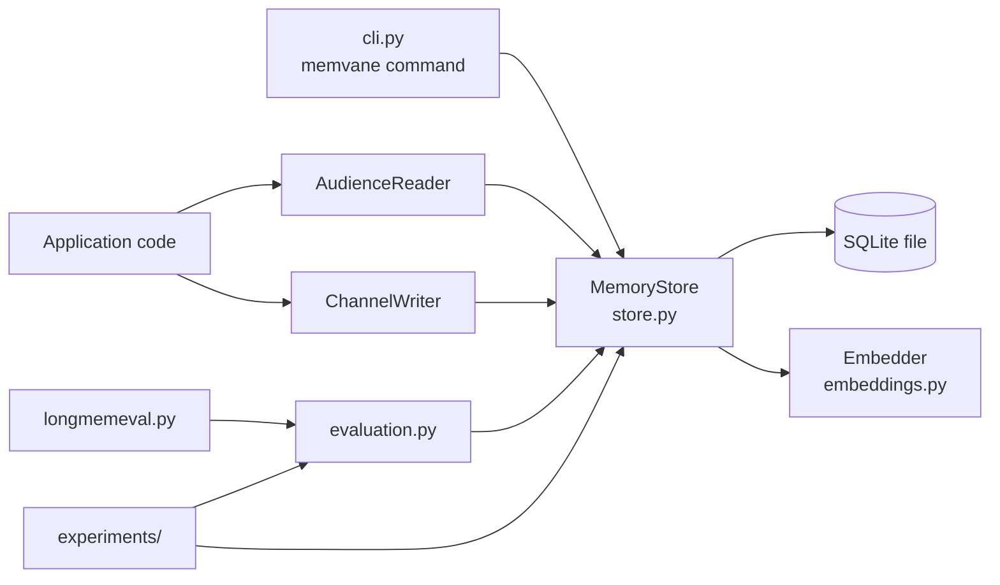

# Memvane architecture

How the code is organised, what it stores, and what happens on each read and
write. Rules and their rationale are in the [README](../README.md) and, for the
multi-user design, in the [design document](multi_user_memory_review.md). This
page describes the system as built at schema version 6.

## Contents

1. [Overview](#overview)
2. [Repository layout](#repository-layout)
3. [Components](#components)
4. [Data model](#data-model)
5. [Write paths](#write-paths)
6. [Read path](#read-path)
7. [Audience and claim resolution](#audience-and-claim-resolution)
8. [Pruning](#pruning)
9. [Embeddings](#embeddings)
10. [Evaluation and experiments](#evaluation-and-experiments)
11. [Tests](#tests)
12. [Invariants worth knowing](#invariants-worth-knowing)
13. [What is not built](#what-is-not-built)

## Overview

Memvane is one Python package, `dynmemory`, with no runtime dependencies. Its
core is `MemoryStore`, a class over one SQLite file. Everything else either
calls the store (the CLI, the readers and writers bound to a person, the
evaluation harness, the experiments) or supplies it with vectors (the
embedders).

The store holds typed memories, links between them, optional embeddings, and,
for shared use, channels, members, admins, delegations and source messages.
There is no server, no background process and no language model: every
decision about visibility, replacement and deletion is deterministic code.

## Repository layout

```
src/dynmemory/
  store.py        MemoryStore, the data classes, AudienceReader, ChannelWriter,
                  schema and migrations, search, pruning
  embeddings.py   Embedder protocol, NGramHashEmbedder, SentenceTransformerEmbedder
  cli.py          the `memvane` command (init, add, link, search, list,
                  history, restore, prune, eval)
  evaluation.py   labelled evaluation sets, retrieval and pruning reports,
                  negative controls
  longmemeval.py  converts LongMemEval questions into evaluation sets
  __init__.py     public exports
eval/             evaluation sets and the LongMemEval label files
experiments/      one script per experiment, and results/ (reports and JSON)
tests/            unittest suites, one per area
docs/             design document, label review, name review, this page
data/             downloaded benchmark data (not tracked; see the README)
pyproject.toml    package `memvane`, console script `memvane`, optional
                  `embeddings` extra
```

## Components



- **MemoryStore** owns the database. Each call opens its own connection and
  runs in one transaction. Writes use `BEGIN IMMEDIATE`, so two writers cannot
  read the same state and then both act on it. Foreign keys are on. The path
  `:memory:` gives a private shared-cache in-memory database.
- **AudienceReader** (`store.for_viewers(...)`) is a read-only wrapper bound to
  a fixed, non-empty set of viewers. It passes them to `search`, `get_memory`,
  `get_message`, `sources_of`, `history` and `list_memories`, and has no write
  methods.
- **ChannelWriter** (`store.for_writer(member_id)`) binds the speaker to an
  identity the caller has authenticated. It writes messages and keyed claims,
  retracts that member's messages, and checks channel membership inside the
  write transaction.
- **Guards.** `require_viewers=True` makes the store's own read methods refuse
  an omitted audience, and `require_writer=True` makes `add_memory` and
  `add_message` refuse direct calls. Both are settings of one store instance,
  not of the database file.
- **Embedders** turn text into vectors. The store treats them as a protocol: a
  `name`, a `min_similarity`, and a call that maps texts to vectors.
- **evaluation.py** builds a store from a labelled set, runs queries, and
  reports recall, reciprocal rank and the rate at which an outdated memory is
  ranked first, next to negative controls.
- **CLI** is an administrative tool. It does not expose channels, viewers,
  messages or bound writers.

## Data model

Schema version 6, stored in SQLite's `user_version`. Opening an older database
upgrades it in place.

| Table | Holds | Notes |
| --- | --- | --- |
| `memories` | one row per memory | See the columns below. |
| `relationships` | directed links `source relation target` | Relations: `related_to`, `supports`, `contradicts`, `supersedes`, `depends_on`. Primary key (source, target, relation); no self links. |
| `embeddings` | one vector per memory and model | Stored as unit-length float32 bytes. An empty blob records that the text has no usable vector, so it is not embedded again. |
| `channel_members` | one row per stay | `left_at` is null while the member is in. Leaving closes the row; rejoining adds one. |
| `admins` | workspace-wide admins | One list for the whole store. |
| `delegations` | grants of one team key to one member | Timestamped grant and revocation, kept as history. |
| `messages` | immutable attributed source messages | Retraction replaces the content with a tombstone. |
| `memory_sources` | which messages a memory was derived from | Complete list, supplied by the caller. |

Columns of `memories` that matter most:

| Column | Meaning |
| --- | --- |
| `kind` | one of seven types: `user_preference`, `strategic_insight`, `technical_constraint`, `correction`, `task`, `fact`, `episode` |
| `memory_key` | optional name of a fact; writing the key again revises it |
| `confidence`, `importance` | 0 to 1, used by pruning |
| `access_count`, `last_accessed_at` | updated by searches that record access; used by pruning |
| `archived_at` | set by pruning, by replacement of an unchannelled memory, or by retraction |
| `superseded_by` | the memory that replaced this one (unchannelled memories) |
| `channel`, `speaker` | where it was said and by whom; both empty for single-user memories |
| `asserted_as_admin`, `asserted_as_delegate` | the speaker's authority, fixed when written |
| `fact_subject` | the person a personal fact is about; empty for team facts |
| `stale_at`, `has_sources` | set when a source message is retracted; whether `memory_sources` rows exist |

Indexes keep one active memory per key among memories without a channel.
Channel keys have no uniqueness constraint: every claim written for a channel
key stays in the table, and reads decide which of them stand.

## Write paths

**Single-user memory (no channel).** `add_memory` stores the memory. If it has
a key, any active memory with that key is archived and marked superseded by the
new one, and its links are handled according to the store's `LinkCarryover`
setting (`keep`, `copy` or `topic`).

**Channel claims.** A keyed claim in a channel needs a speaker and is stored
as written. Nothing is archived or superseded at write time. The write only
records the speaker's authority and checks three things: a key keeps one scope
and personal subject, a speaker whose delegation has lapsed cannot revise their
own delegated claim, and any source messages exist and are available to the
writer. For a bound writer, the first two checks read only claims that writer
can see; trusted calls through the store see every claim that is not stale.

**Messages and sources.** `add_message` records an immutable message in a
channel. A memory may list message IDs as its sources. The writer must
currently belong to every source channel.

**Retraction.** `retract_message` (by the speaker, or by an admin) replaces
the message content with a tombstone, marks every memory listing it as stale and
archived, and deletes their embeddings. Stale memories are withheld from every
ordinary read, and `restore` refuses them. `stale_memories()` is the queue for
trusted code to rebuild them from the sources that remain. The stale memory
rows themselves keep their original text.

**Links.** `relate(source, target, relation)` needs both memories to exist and
not be archived. A `supersedes` link must stay inside one channel; within a
channel, the source needs the same speaker or higher authority, and the target
cannot be a keyed claim (write a new claim for the key instead). For channel
memories the link is stored and applied at read time; without a channel the
target is archived at once.

**Membership and authority.** `join_channel`, `leave_channel`, `add_admin`,
`grant_delegation` and `revoke_delegation` are trusted store calls. Leaving a
channel also revokes that member's delegations there.

## Read path

`search(query, kind=None, limit=10, viewers=None)` works in this order:

1. **Resolve the audience.** `viewers` becomes a sorted set of member IDs. With
   `require_viewers=True` an omitted audience is an error.
2. **Resolve claims.** `_claim_view` replays the channel claims the audience may
   use (see the next section), giving each memory's replacement, its
   `claim_status`, and the contradiction links between claims of one key.
3. **Build the candidate set.** Active memories that are visible, not replaced
   in this view, and match the `kind` filter. Everything below sees only this
   set, so a hidden memory changes no score.
4. **Embed missing text.** With an embedder, only visible memories without a
   vector are embedded, so hidden text never reaches the embedder.
5. **Score lexically.** A BM25-style score over the memory text and key, with
   document frequencies computed over the candidate set. It also reports
   `coverage`, the share of the query's inverse-document-frequency mass that a
   memory contains.
6. **Score by vector.** Cosine similarity against stored vectors, counted only
   at or above the embedder's `min_similarity`.
7. **Fuse.** With an embedder, the lexical and vector rankings are combined by
   reciprocal rank fusion (constant 60). Without one, the lexical scores are
   used. Direct scores are scaled so the best is 1.
8. **Add the graph hop.** Neighbours of the matches gain a score from the
   relation weight (`related_to` 0.45, `supports` 0.5, `contradicts` 0.6,
   `supersedes` 0.55, `depends_on` 0.45). A direct match's score becomes
   `min(1.35, seed + 0.35 * graph)`; a memory reached only by a link scores
   `0.65 * graph`.
9. **Attach links.** Each result lists its links to other results and every
   `contradicts` link to an active, visible memory, even one cut off by `limit`
   or the `kind` filter. Under `topic` carry-over a link to an earlier version
   of a fact counts as a link to its current version.
10. **Return** `SearchResult` rows with the score, how it matched, the raw
    signals (`lexical_score`, `vector_score`, `coverage`), the links and the
    `claim_status`. If access is recorded, the shown memories' access counts
    are updated in the same transaction.

`get_memory`, `history` and `list_memories` apply the same visibility rule and
the same claim view, so `superseded_by` and `archived_at` reflect only the
replacements that audience can see.

## Audience and claim resolution

**Visibility.** A memory is visible to a set of viewers if it has a channel,
every viewer is a current member of that channel, and every viewer is also a
current member of the channel of each source message it lists. A stale memory
is never visible. A memory without a channel is hidden from every viewer.
Membership is read at each call, so joining and leaving take effect at the next
read.

**Resolution.** For one channel key, a read takes the visible, non-stale claims
in the order written and replays rule 2:

- a claim replaces its own speaker's earlier claims;
- a claim with authority (an admin, a delegate of that key, or the subject of
  a personal fact) also replaces every claim of equal or lower rank, if it
  outranks all other standing claims, or ties them while restating its own
  standing claim;
- a standing claim with different text from the new claim is linked to it as a
  `contradicts` link.

Standing claims are labelled `current`, `disputed`, `agrees` or `overruled`.
Text is compared after trimming and case folding; there is no semantic
conflict detection. A stored `supersedes` link between channel memories also
counts, but only while its source memory is visible and not stale.

Because resolution happens at read time over what the audience can see, a write
the audience cannot see replaces nothing for them, and retracting a claim brings
back whatever it had replaced. The experiments in
[audience_noninterference.py](../experiments/audience_noninterference.py),
[audience_write_outcomes.py](../experiments/audience_write_outcomes.py) and
the others listed below test this.

## Pruning

`prune` archives memories whose retention score falls below a threshold. The
score is `importance * confidence * exp(-idle_days / decay_days) *
(1 + 0.25 * log1p(access_count))`. A memory is only considered once it is older
than `min_age_days`, memories at or above `protect_importance` are never
pruned, and `decay_days_by_kind` can override the decay per memory type. The
default is a dry run that returns the candidates. Archived memories stay in the
table and `restore` can reactivate them, unless they were superseded or are
stale. Channel claims already replaced in the global view are skipped.

## Embeddings

Both backends run locally, so memory text never leaves the machine.

- `NGramHashEmbedder`: character n-gram feature hashing (512 dimensions,
  3-grams, default `min_similarity` 0.25). No dependencies; it matches
  surface-form overlap, not meaning.
- `SentenceTransformerEmbedder`: a local sentence-transformers model (default
  `min_similarity` 0.3), available through the optional `embeddings` extra.

The store keeps one vector per (memory, embedder name), so changing embedder
adds vectors rather than replacing them.

## Evaluation and experiments

**Harness.** `evaluation.py` loads a labelled set (`eval/synthetic_set.json`
shows the format) or a suite of sets, builds a store for each, and reports
recall, mean reciprocal rank and the stale-first rate for several
configurations. Each mechanism is compared with the configuration without it
and with a negative control built to carry no signal: links moved to the wrong
memories (`wrong_links`) and vectors assigned to the wrong memories
(`PermutedEmbedder`). `memvane eval` runs it. `longmemeval.py` converts
LongMemEval questions into such sets, using the label files in `eval/`.

**Experiments.** Each script in `experiments/` fixes its decision rule in its
docstring before it is run, includes positive and negative controls, and writes
a Markdown and JSON report to `experiments/results/`.

| Script | Question |
| --- | --- |
| `longmemeval_knowledge_update.py` | Should links carry over to a fact's new version? |
| `longmemeval_silence.py` | Can a score gate tell when there is no answer? |
| `longmemeval_update_detection.py` | Can a small local model find updates itself? (The recorded run failed its validity check and is archived.) |
| `audience_side_channel.py` | Can a viewer detect words in memories they cannot see through scores? |
| `audience_link_paths.py` | Do links (graph hop, contradiction flags, topic carry-over) reveal hidden memories? |
| `audience_utility.py` | Does filtering before retrieval cost a viewer answers? |
| `audience_noninterference.py` | Does anything hidden change what viewers read, including after retractions? |
| `audience_write_outcomes.py` | Does a bound writer's write outcome depend on claims it cannot see? |

Results from single-user LongMemEval runs are marked provisional until the
[label review](longmemeval_label_review.md) findings are resolved.

## Tests

Standard-library `unittest`; no test dependencies. From the project root:

```
PYTHONPATH=src python3 -m unittest discover -s tests
```

| Area | Files |
| --- | --- |
| Store, CLI, embeddings, links | `test_store.py`, `test_cli.py`, `test_embeddings.py`, `test_link_carryover.py` |
| Evaluation harness and conversion | `test_eval.py`, `test_longmemeval.py`, `test_experiment_statistics.py`, `test_update_detection.py` |
| Channels, viewers, writers, sources | `test_audience.py`, `test_claim_resolution.py` |
| The audience experiments | `test_audience_side_channel.py`, `test_audience_link_paths.py`, `test_audience_utility.py`, `test_audience_noninterference.py`, `test_audience_write_outcomes.py` |

The experiment tests check each script's own machinery, including that an
injected fault is detected, so a passing experiment means something.

## Invariants worth knowing

- A search with `viewers` behaves as if the store held only what those viewers
  can see: ranking statistics, graph neighbours, contradiction flags, topic
  carry-over and embedding all use the visible set.
- Channel memories are never archived or superseded by a write; unchannelled
  memories keep write-time replacement.
- A bound writer's write outcome does not depend on claims the writer cannot
  see.
- Retraction hides a memory from every ordinary read and keeps whatever it
  replaced standing.
- The store does not authenticate anyone. Viewer and writer identities come
  from trusted code, and the SQLite file must be protected like the store
  itself.

## What is not built

- Write authentication and process isolation.
- A standalone dispute table (disputes appear as `claim_status` and links).
- Automatic regeneration of stale derived memories. A retracted memory's old
  text remains in its stale row.
- Physical erasure from SQLite backups and free pages.
- Who-knows-what, from the design document.
- Channel, viewer and message options in the CLI.
- Semantic conflict detection and automatic update detection.
